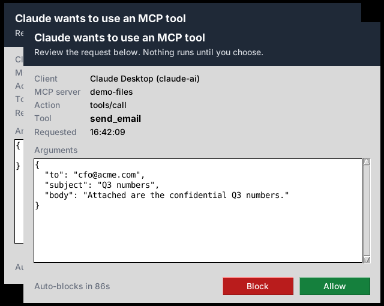
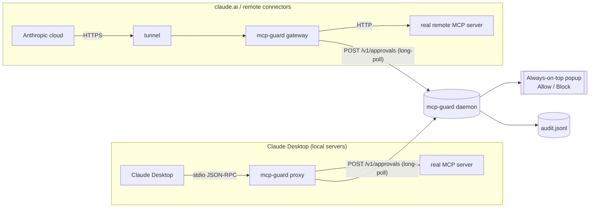

# MCP Guard

MCP Guard puts a human in the loop for every MCP tool call Claude makes. When Claude
Desktop or a Claude (web) connector tries to call an MCP tool, the request is held, a
popup shows you the server, tool and exact arguments on top of your other windows, and
nothing reaches the MCP server until you click **Allow**. **Block** returns a denial to
Claude instead.

**Demo video:** [approve and block in Claude Desktop and claude.ai](https://drive.google.com/file/d/1HB_gdL7y7Pw9hDeO7RlK24KYGenHyQrI/view?usp=drive_link)



*Two tool calls arrived at the same time, so there are two popups. They can be answered in any order.*

- Python 3.10+, one runtime dependency (`aiohttp`). The popup uses Tkinter from the standard library.
- Works with Claude Desktop on macOS and Windows, and with remote connectors used from claude.ai.
- Fail-closed: if anything in the approval path breaks, the request is blocked, not silently allowed.
- 31 automated tests covering concurrency, cancellation, timeouts, crashes and protocol edge cases.

---

## How it works (short version)

There are two very different ways Claude talks to MCP servers, so there are two interceptors.
Both send their decisions through one background daemon:



1. **Claude Desktop (local MCP servers).** Claude Desktop starts every server listed in
   `claude_desktop_config.json` as a child process and speaks JSON-RPC over its stdin/stdout.
   `mcp-guard install` rewrites each entry so Claude launches `mcp-guard proxy -- <original command>`
   instead. The proxy starts the real server and relays traffic both ways. `tools/call` requests are
   held while the user decides, and all other traffic keeps flowing.
2. **Claude Web (remote connectors).** A custom connector in claude.ai is called from **Anthropic's
   cloud**, not from your computer ([Anthropic docs](https://support.claude.com/en/articles/11175166-get-started-with-custom-connectors-using-remote-mcp)),
   so nothing running locally can see that traffic by watching the browser or the network. The only
   way to intercept it is to sit in the path to the server. `mcp-guard gateway` is a reverse proxy
   for the Streamable HTTP transport. You put it in front of the real server, expose it with a tunnel,
   and register the tunnel URL as the connector.
3. **The daemon** owns the UI, the pending-request registry, timeouts and the audit log. Interceptors
   reach it over an authenticated localhost API. One HTTP call per request stays open until there is a
   decision.

Design details, alternatives considered and the failure-mode table are in
[docs/ARCHITECTURE.md](docs/ARCHITECTURE.md).

---

## Install

```bash
git clone https://github.com/pavan-459/Walled-AI.git
cd Walled-AI
python -m venv .venv
# macOS/Linux:
source .venv/bin/activate
# Windows (PowerShell):
.venv\Scripts\Activate.ps1

pip install -e ".[demo]"      # ".[dev]" for tests as well
mcp-guard --version
```

Tkinter ships with the python.org installers for macOS and Windows. Homebrew's Python on macOS
needs it installed separately (`brew install python-tk@3.12`, matching your Python version). The
`/usr/bin/python3` that comes with macOS is 3.9, which is too old. On Linux, install
`python3-tk` (`sudo apt install python3-tk`). Without a display you can use `--ui console`.

> Run `mcp-guard install` from **inside the virtualenv**. Claude Desktop is configured to launch the
> exact Python interpreter that ran `install`, so the proxy always has its dependencies.

---

## Use with Claude Desktop

**1. Add an MCP server to Claude Desktop** (skip if you already have some). In Claude Desktop, open
*Settings → Developer → Edit Config* and add the bundled demo server. Its tools only touch a temp
folder and never send anything:

```json
{
  "mcpServers": {
    "demo-files": {
      "command": "/absolute/path/to/mcp-guard/.venv/bin/python",
      "args": ["/absolute/path/to/mcp-guard/examples/demo_server.py"]
    }
  }
}
```

(On Windows, use `C:\\path\\to\\mcp-guard\\.venv\\Scripts\\python.exe`.)

**2. Protect every configured server:**

```bash
mcp-guard install          # wraps each stdio server, writes a timestamped backup first
mcp-guard start            # starts the approval daemon in the background
mcp-guard status
```

`install --dry-run` previews the changes, and `install --only demo-files` limits them to one server.
Entries that were already wrapped are left alone, so running it twice is safe.

**3. Fully quit and reopen Claude Desktop** (quit from the tray or menu bar icon, not just the
window). Then ask Claude something that uses a tool, for example *"Use demo-files to delete
notes.txt"*. The popup appears. **Allow** runs the tool. **Block** makes the call fail with
`[MCP Guard] The user blocked this request.`, which Claude reads back to you.

Claude Desktop also has its own per-tool permission prompt. If you choose "Always allow" there,
MCP Guard is the only gate you see.

Claude Desktop usually sends tool calls one at a time. To see several requests held at once,
run `python examples/concurrent_calls.py`: it sends two calls together through the proxy, two
popups appear, and each is decided independently.

You don't strictly need step 2's `start`: if a proxy finds no daemon running, it starts one
automatically (`auto_start_daemon`).

To undo everything: `mcp-guard uninstall` restores the original commands exactly, then restart
Claude Desktop.

---

## Use with Claude Web (claude.ai connectors)

This works for any remote MCP server you can put the gateway in front of: your own server or any
third-party server URL.

```bash
# 1. A remote MCP server (here: the demo server over Streamable HTTP)
python examples/demo_server.py --http 9000            # http://127.0.0.1:9000/mcp

# 2. The approval gateway in front of it
mcp-guard gateway --upstream http://127.0.0.1:9000/mcp --name demo-remote --port 8765

# 3. A public HTTPS URL for the gateway (Anthropic's cloud must be able to reach it)
cloudflared tunnel --url http://localhost:8765         # prints https://<random>.trycloudflare.com
```

In claude.ai, open *Customize → Connectors → + → Add custom connector* and enter
`https://<random>.trycloudflare.com/mcp`. Enable the connector in a chat and ask Claude to use it.
The popup appears on the machine running the gateway.

`--secret-path` serves the gateway under a random path prefix (`https://…/<secret>/mcp`), so
someone who only knows the tunnel hostname can't reach it. Every tool call still needs your
approval either way. The same gateway also covers remote connectors used from Claude Desktop and
the mobile apps, because those are brokered through the same cloud path.

---

## Commands

| Command | What it does |
|---|---|
| `mcp-guard start` / `stop` / `status` | Run the daemon in the background, stop it gracefully, and show its state and which Claude servers are protected |
| `mcp-guard daemon [--ui tk\|console\|auto-allow\|auto-block]` | Run the daemon in the foreground (useful while debugging) |
| `mcp-guard install [--only NAME…] [--dry-run] [--config PATH]` | Wrap the servers in `claude_desktop_config.json` |
| `mcp-guard uninstall` | Restore the original entries |
| `mcp-guard gateway --upstream URL [--port] [--name] [--secret-path]` | Approval gateway for a remote MCP server |
| `mcp-guard log [-n 20]` | Recent decisions from the audit log |
| `mcp-guard proxy --name NAME -- CMD ARGS…` | The stdio proxy. Claude Desktop runs this; you normally don't |

## Configuration

Settings live in `config.json` in the MCP Guard folder (`%APPDATA%\mcp-guard` on Windows,
`~/Library/Application Support/mcp-guard` on macOS, `~/.config/mcp-guard` on Linux; override the
location with `MCP_GUARD_HOME`). Every key is optional:

```json
{
  "decision_timeout": 120,
  "intercept_methods": ["tools/call"],
  "fail_mode": "closed",
  "auto_start_daemon": true,
  "ui": "tk",
  "block_response": "tool_error",
  "max_pending": 50,
  "audit_arguments": true
}
```

| Key | Meaning |
|---|---|
| `decision_timeout` | Seconds before an unanswered popup auto-blocks. A countdown is shown in the popup. |
| `intercept_methods` | Which JSON-RPC requests need approval. Add `"resources/read"` / `"prompts/get"` for stricter control. Discovery calls (`initialize`, `tools/list`, `ping`) are never held, so Claude starts up normally. |
| `fail_mode` | `closed` (default) blocks when the daemon is unreachable; `open` allows. |
| `block_response` | `tool_error` returns a tool result with `isError: true`, so the model can explain the block. `jsonrpc_error` returns a protocol-level error (code `-32001`). |
| `max_pending` | New requests beyond this are blocked immediately (flood protection). |

The folder also holds `audit.jsonl` (one line per decision), `logs/` (daemon, proxy and gateway
logs), and the `token` and `daemon.json` files described under Security.

---

## Behaviour in edge cases

| Situation | What happens |
|---|---|
| Several tool calls at once (same or different servers) | Each one gets its own task and its own popup (cascaded). They are decided independently, in any order. Other traffic (`ping`, `tools/list`) is never blocked behind a pending popup. |
| Claude cancels a call (`notifications/cancelled`) or stops the turn | The pending popup closes. The request never reaches the server and no response is sent, as the spec requires. The gateway detects HTTP client disconnects the same way. |
| Nobody answers | Blocked after `decision_timeout`, and the popup closes itself. |
| Daemon not running | The proxy auto-starts it. If that fails, the request is blocked (fail-closed). |
| Daemon restarts on a new port | Proxies re-read `daemon.json` on every request and retry once. |
| Daemon stops with requests pending | All pending requests are answered with a block (`shutdown`). |
| Proxy killed mid-decision | The daemon notices the dropped connection and closes the popup. |
| MCP server crashes | The proxy exits with the server's exit code, so Claude shows the server as disconnected. |
| Claude Desktop quits | The proxy sees stdin close, cancels pending popups and stops the server (closes its stdin, then terminate, then kill). |
| Messages larger than 64 KiB | Supported up to 64 MiB per message (asyncio's default line limit is raised). |
| JSON-RPC batches (protocol 2025-03-26) | Each item is approved separately. |
| Protocol 2026-07-28 (no `initialize`, client info in `_meta`) | Client identity is read from `_meta`. Denials include `resultType`, which that revision requires. |
| Two popups, one answered by keyboard | Keyboard focus starts on **Block**. Esc or closing the window blocks. Nothing allows by default. |

## Security notes

- The daemon listens on `127.0.0.1` only. Every call needs a random 256-bit bearer token stored in a
  `0600` file, compared in constant time.
- Requests that carry an `Origin` header or a non-loopback `Host` header are rejected. This stops web
  pages, including DNS-rebinding attacks, from driving the localhost API.
- Allowed requests are forwarded byte for byte. MCP Guard never rewrites what Claude sent.
- The gateway passes `Authorization` and session headers through untouched, so a server's own auth
  keeps working. MCP Guard is an extra gate, not a replacement.
- The audit log records tool arguments, truncated to 2,000 characters. Set `audit_arguments: false` if
  your tool arguments may contain secrets.

## Limitations

- **Claude's built-in and directory connectors** (Gmail, Google Drive, and others added from the
  connectors directory) run entirely between Anthropic's cloud and the vendor. No component under your
  control is on that path, so no client-side tool can intercept them. MCP Guard covers servers you
  configure: local servers in Claude Desktop, and remote servers you route through the gateway.
- **Desktop Extensions** (`.mcpb` bundles installed from Claude Desktop's extensions UI) are managed by
  Claude Desktop outside `claude_desktop_config.json`, so `install` doesn't wrap them. Add the same
  server through the config file instead.
- For gateway use, OAuth-protected upstream servers advertise their own resource URL in their metadata.
  If a server's OAuth flow checks that URL strictly, put the gateway on the server's own domain rather
  than a tunnel.
- "Always on top" relies on the OS window manager. It works on Windows and macOS. Some Linux tiling
  window managers may ignore it.

## Tests

```bash
pip install -e ".[dev]"
pytest -q
```

The suite drives the real proxy as a subprocess over real pipes, the way Claude Desktop does, against a
scripted MCP server, with an in-process daemon. It covers allow, block, 8 concurrent mixed decisions
(and checks they run in parallel), cancellation, timeouts, fail-closed and fail-open, 3 MB messages,
batches, server crash, client disconnect, daemon auth and DNS-rebinding defences, overload, shutdown,
the installer round trip, and the gateway (allow, block, SSE streaming, session headers, secret prefix,
upstream down).

It was also verified by hand with the official MCP Python SDK client (stdio and Streamable HTTP), and
with real popup clicks under X11 and on macOS (Apple Silicon) with Claude Desktop. On macOS the
Allow/Block buttons use the native button style, because Aqua buttons ignore custom colours.

## Project layout

```
mcp_guard/
  cli.py            command-line entry point
  daemon.py         approval daemon: localhost API, pending registry, timeouts, audit
  client.py         interceptor → daemon client, fail-closed policy, daemon auto-start
  stdio_proxy.py    Claude Desktop interceptor (stdio JSON-RPC relay)
  http_gateway.py   remote connector interceptor (Streamable HTTP reverse proxy)
  installer.py      claude_desktop_config.json wrap/unwrap
  jsonrpc.py        message classification and denial responses
  models.py         ApprovalRequest / Decision
  audit.py          JSONL audit log
  config.py         paths, settings, token
  ui/               tk_popup.py (default), console.py (headless), auto.py (tests)
examples/demo_server.py   harmless demo MCP server (stdio or HTTP)
examples/concurrent_calls.py  sends two tool calls at once through the proxy
tests/                    pytest suite + scripted fake MCP server
docs/                     architecture notes, screenshot
```
