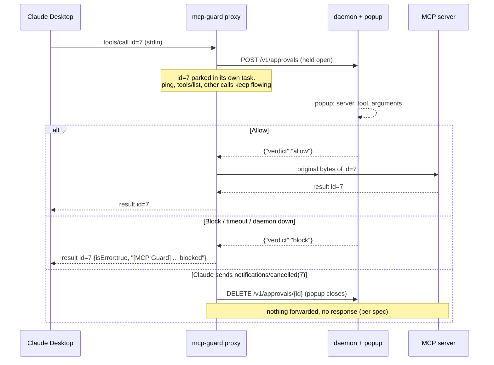

# Architecture

## The problem: where does MCP traffic actually flow?

Interception only works where the traffic can be observed. Claude uses MCP in two ways:

| Client | Transport | Who opens the connection | Observable from the user's machine? |
|---|---|---|---|
| Claude Desktop, local servers (`claude_desktop_config.json`) | stdio: newline-delimited JSON-RPC over the child process's stdin/stdout | Claude Desktop, locally | Yes, but only by being the process Claude launches. There is no network traffic to sniff. |
| claude.ai / Claude Desktop / mobile, remote connectors | Streamable HTTP (HTTPS) | Anthropic's cloud | No. The browser never talks to the MCP server. The path is Anthropic's cloud → the server URL. |

So there is no single place on the user's machine where "all MCP traffic" passes. MCP Guard uses
the one reliable interception point for each case and joins them in a shared decision service.

## Alternatives considered

| Approach | Why not |
|---|---|
| Packet capture or a local HTTPS MITM proxy | stdio traffic never touches the network. Remote connector traffic never touches the user's network either. |
| Browser extension on claude.ai | The browser doesn't make the MCP calls, so an extension can at most see UI events, and it can't hold or deny a request. |
| Patching Claude Desktop (Electron/asar injection, DLL injection, `ptrace`) | Breaks on every app update, needs code-signing workarounds, is platform-specific, and tampers with a signed app. That isn't something a security product should require. |
| OS-level process hooking or file-descriptor interposition | Platform-specific, needs elevated privileges, and is fragile. |
| **Config-level stdio proxy** (chosen for Desktop) | Uses Claude Desktop's documented extension point (`command` + `args`). Cross-platform, no privileges, survives app updates, fully reversible, sees 100% of the server's traffic. |
| **Reverse proxy in front of the server** (chosen for remote) | The only point on the remote path that the user controls. It is also the standard pattern for gateways and WAFs. |

## Components

```
            ┌──────────────── user's machine ─────────────────┐
Claude ──▶  │ mcp-guard proxy (one per MCP server) ──▶ server │
Desktop     │        │                                        │
            │        ▼   POST /v1/approvals (long-poll)        │
            │  mcp-guard daemon ──▶ Tk popup (main thread)     │
            │        ▲             └─▶ audit.jsonl             │
            │        │                                        │
claude.ai ─▶ tunnel ─▶ mcp-guard gateway ──▶ remote MCP server │
            └─────────────────────────────────────────────────┘
```

### Daemon (`daemon.py`)

- Runs an aiohttp server on `127.0.0.1:<random port>`. It writes `{port, pid}` to `daemon.json` so
  interceptors can find it after a restart without any configuration.
- `POST /v1/approvals` registers a pending request (an `asyncio.Future`), tells the UI to show it, and
  awaits the future with `wait_for(decision_timeout)`. The HTTP response *is* the decision, so there is
  no polling and no extra round trips.
- `DELETE /v1/approvals/{id}` resolves a pending request as cancelled. `handler_cancellation=True`
  means a dropped interceptor connection also cancels the wait, which closes the popup.
- Threading: Tk must own the main thread on macOS, so with the Tk UI the asyncio server runs on a
  worker thread. The UI hands decisions back with `loop.call_soon_threadsafe`. The loop hands work to
  the UI through a `queue.Queue` that Tk drains every 50 ms. No widget is ever touched off the Tk thread.
- On shutdown (signal or `mcp-guard stop`), every pending request is resolved as a block before the
  API closes.

### Stdio proxy (`stdio_proxy.py`)



- **stdin** is read on a thread, because async stdin pipes aren't supported on Windows. Lines go onto
  an asyncio queue.
- **The child server** runs via `asyncio.create_subprocess_exec` with a 64 MiB line limit. Its stderr
  is inherited, so its logs still land in Claude's `mcp-server-*.log`.
- **Each held request** is its own task, keyed by JSON-RPC id. That is what makes concurrent requests
  independent. Writes to the server and to Claude are serialised with locks, so messages never interleave.
- **Allowed requests are forwarded as the original bytes**, not re-serialised JSON.
- The proxy records `clientInfo` from `initialize` (or from `_meta` on 2026-07-28 sessions) and
  `serverInfo` from the server's reply, so the popup can say who is asking and which server would run it.
- **Exit:** if Claude closes stdin, the proxy cancels held requests and stops the server gracefully
  (close stdin, then terminate, then kill). If the server exits, the proxy exits with its code. It ends
  with `os._exit` because the stdin thread may be blocked in `readline()`, which would otherwise abort
  interpreter shutdown.

### HTTP gateway (`http_gateway.py`)

- Catch-all aiohttp handler. A `POST` body that parses to an intercepted request is held. Everything
  else (`GET` SSE streams, `DELETE` session teardown, OAuth metadata paths, notifications) is proxied
  unchanged.
- Upstream responses are streamed chunk by chunk (`iter_any`), so SSE progress events arrive live.
  `auto_decompress=False` keeps bodies byte-identical. Hop-by-hop headers are dropped, and
  `Authorization`, `Mcp-Session-Id` and `Mcp-Protocol-Version` pass through.
- A watcher checks the client transport every 0.5 s while a decision is pending. If Claude's side
  disconnects, the approval is cancelled and the popup closes.
- Blocked requests are answered by the gateway itself with a JSON response carrying the same
  JSON-RPC id. They never reach the upstream server.

### Client and failure policy (`client.py`)

All interceptors share `DecisionClient.request_approval`, which never raises:

| Failure | Result |
|---|---|
| No `daemon.json` or token | Auto-start the daemon (lock file prevents a race between several proxies), wait up to 8 s, else block |
| Connection refused (stale `daemon.json`, crashed daemon) | Auto-start the daemon and retry once, else block |
| Non-200 response, malformed JSON | Block |
| `fail_mode: "open"` | The above allow instead of block (explicit opt-in) |

Every block carries a reason (`user`, `timeout`, `cancelled`, `daemon_unavailable`, `shutdown`,
`overloaded`, `error`). The reason is shown to Claude in the denial text and recorded in the audit log.

## Security model

The threat being addressed is an AI agent invoking tools the user didn't intend. That includes
prompt-injection-driven tool calls. The security-relevant properties:

1. **Default deny.** Timeouts, crashes, unreachable daemon, UI errors and window close all block.
   Keyboard focus starts on Block.
2. **The approval channel can't be spoofed by web content.** The localhost API requires a secret from a
   user-only file, and rejects requests with an `Origin` header or a non-loopback `Host` (CSRF and DNS
   rebinding).
3. **What you approve is what runs.** The popup shows the exact `params` of that request, and the proxy
   forwards those exact bytes.
4. **Bounded resources.** `max_pending` caps outstanding approvals, and request bodies to the daemon are
   size-limited.
5. **Auditability.** Every decision is appended to `audit.jsonl` with timing and reason.

## Protocol compatibility

- Stdio framing: one JSON-RPC message per line (MCP spec). Non-JSON lines are passed through, so the
  server reports the parse error itself.
- Methods are classified per message. Only requests (messages with an `id`) for `intercept_methods` are
  held. Notifications and responses (server→client requests such as sampling or elicitation, and the
  client's answers to them) are never held.
- Batches (2025-03-26) are approved per item.
- 2026-07-28 sessions have no `initialize` handshake. Client identity is read from
  `params._meta["io.modelcontextprotocol/clientInfo"]`, and denials include `resultType: "complete"`.
  Older peers ignore that field. Verified against MCP Python SDK 2.3 on both transports.
